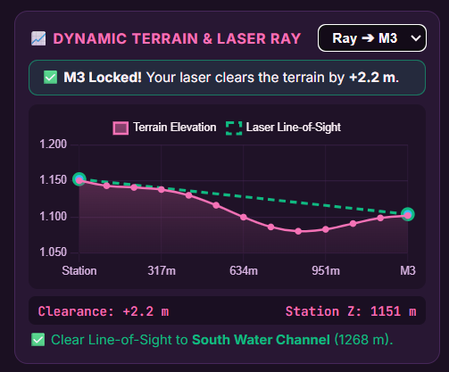

# 🌍 TOPO-RUSH: Total Station Elevation & Line-of-Sight GeoGame

>  **🔗 Live Web Application Link:**  
> 

🎯 **Objective of the game :** In the real world, a "total station"—an instrument used for topographic surveying—measures beams reflected from three target prisms (M1, M2, and M3). If a terrain feature—such as a ridge, a valley slope, or any other obstacle—lies along the direct laser path between the instrument and a target, the measurement is obstructed.

👷‍♂️ Players act as a **Field Geomatics Engineer** racing against a countdown timer across **6 distinct topographic regions of Turkey**, placing a Total Station on optimal high , dry terrain to achieve an unobstructed Line-of-Sight to all targets .

❓ After each level, you will be presented with a multiple-choice question regarding the region's geography; answering correctly grants a bonus.

⏳ Each time you set up the Total Station in an unsuitable location, time is deducted from your remaining clock—the amount of time lost depends on the level's difficulty.

📈 You can monitor the laser's Line-of-Sight to each target via a graph located on the right-hand panel.

🛰️ Additionally, you may select the setup location for the Total Station using satellite imagery.

 On the topographic map, you can interpret elevation data by observing the contour lines (isohypses).

🔥❄️ As you move closer to or further from the ideal setup location, the "Chief Surveyor" will provide guidance using a "hot or cold" (warmer/colder) feedback system.

### ⚙️ Functional Requirements

1. **Interactive Spatial Map & Multi-Layer Switching:** Renders real-world topographic contour maps (**OpenTopoMap / SRTM**) and high-resolution satellite imagery (**Esri World Imagery**) via **Leaflet.js**

2. **Real-Time Elevation & Line-of-Sight (LoS) Calculation:** Samples 12 intermediate terrain points along every station-to-target vector using the **Open-Elevation DEM API** (with a deterministic trigonometric DEM fallback) and 
**Turf.js** geodesic distance calculations.

3. **Interactive Terrain Profile & Laser Ray Analyzer:** Plots terrain cross-sections against the linear laser ray in **Chart.js**, highlighting blocking ridges in red and calculating vertical clearance in meters.

4. **Hard-Hat Field Engineer Coach (Dialogue Bubble):** Provides dynamic, directional hot/cold spatial feedback (`North`, `South-East`, target elevation thresholds) inside an overhead speech bubble above the field engineer avatar.

5.  **Post-Stage 3D Side-View Relief & Regional Topography Quiz:** Generates an animated 3D hypsometric block relief model of each surveyed city alongside a randomized multiple-choice topography question (`+100 pts` bonus).

6.  **Persistent High-Score & Sound Effects:** Saves the player's all-time best score via `localStorage` and synthesizes Web Audio API feedback tones.

## 2. Frontend Layout & Wireframe Sketch

+---------------------------------------------------------------------------------------------------+
| 🌍 TOPO-RUSH  [Total Station Elevation & Line-of-Sight Game] | 🔊 | STAGE | TIME | LIVES | SCORE |
+---------------------------------------------------------------+-----------------------------------+
|                                                               | 📐 SURVEY TELEMETRY               |
|  [● Region Name & Difficulty]           [Guide | Topo | Sat]  | Station Z | Setups | Measured     |
|                                                               +-----------------------------------+
|  +----------------------------------------+                   | 🎯 TARGETS (M1 - M3)              |
|  | 👷 FIELD ENGINEER      [Cursor: ~1245m]|                   | • 🏔️ M1 - Target 1   ✅ 1210 m   |
|  | "Pick a hill above >1230m toward East!"|                   | • 🏞️ M2 - Target 2   ❌ Blocked  |
|  +------\/--------------------------------+                   | • 🏛️ M3 - Target 3   ⏳ Waiting  |
|      ( 👷 ) [Chief Surveyor]                                  +-----------------------------------+
|                                                               | 📈 DYNAMIC TERRAIN & LASER RAY    |
|                     [ Interactive Leaflet ]                   | [Ray ➔ M1 ▼]                      |
|                     [   Topographic Map   ]                   | +-------------------------------+ |
|                     [   with Pink Survey  ]                   | |  Chart.js Elevation Profile   | |
|                     [   Boundary & Lasers ]                   | |  --- Laser Ray vs Terrain --- | |
|                                                               | +-------------------------------+ |
|         [ Toast Hint Banner ]   [ View 3D Relief & Next ➔ ]   | Clearance: +12.4 m | Min Z: 1228m |
+---------------------------------------------------------------+-----------------------------------+

## 3. Game Progression, Tasks, Lives, Scoring & Temporal Mechanics

### Progression & Tasks (6 Stages • 18 Survey Targets • 6 Topography Quizzes)
Players progress through **6 increasingly complex regions of Turkey** (`Easy` ➔ `Expert`). Each stage requires measuring **3 prism targets ($M1, M2, M3$)** via unobstructed Line-of-Sight (LoS) and answering **1 regional topography question** (**24 total tasks**):

| Stage | Region & Province | Difficulty | Topographic Challenge |
| :--- | :--- | :--- | :--- |
| **1** | Cappadocia – Goreme (Nevsehir) | Easy | Volcanic tuff valleys & fairy chimney ridges |
| **2** | Salt Lake Basin – Aksaray | Easy | Flat closed basin surrounded by low steppe hills |
| **3** | Uludag – Mountain Ridge (Bursa) | Medium | Steep mountain shoulders requiring high ridge placement |
| **4** | Pamukkale – Terraces (Denizli) | Medium | Stepped travertine terraces viewed from the eastern plateau |
| **5** | Kackar – Ayder Highland (Rize) | Hard | Deep V-shaped Firtina Creek valley walls |
| **6** | Nemrut Caldera – Tatvan (Bitlis) | Expert | Volcanic caldera lake hazard zone + steep crater rim |

### Lives, Scoring & High-Score Mechanism
* **Lives (`♥ ♥ ♥`):** Players start with **3 lives**. Clicking outside the pink survey box or inside water (e.g., Nemrut Crater Lake) deducts **1 life** and **10 seconds**.
* **Scoring & High Score:**
  * **+100 pts** per measured target ($M1, M2, M3$) and **+100 pts** per correct topography quiz answer.
  * **+250 pts (1-Shot Bonus)** for measuring all 3 targets from a single station setup.
  * **+5 pts × remaining seconds** upon completing Stage 6.
  * All-time high score is persisted automatically via `localStorage` (`toporush_high_score_v1`) and shown in the HUD (`BEST`).

### Temporal Component
* **90-Second Countdown (`01:30`):** Time actively drives risk-reward decisions.
* **Penalties & Bonuses:** Relocating the Total Station costs **-6s** (increasing by `-2s` per repeated setup in the same stage); a `0/3` visibility placement costs an extra **-4s**; out-of-bounds/water clicks cost **-10s**; clearing a stage adds **+20s**.

## 4. JavaScript Libraries & Open Datasets

### JavaScript Libraries
* **Leaflet.js (`v1.9.4`):** Interactive Web GIS map, custom SVG markers, animated laser rays, survey boundaries, and water hazard zones.
* **Chart.js (`v4.x`):** Real-time terrain elevation cross-section profile overlaid with the dashed laser line-of-sight vector and red blocking-ridge markers.
* **Turf.js (`v6`):** Geodesic distance calculations (`turf.distance`) for instrument range and lake hazard validation.
* **HTML5 Canvas 2D & Web Audio API:** Renders the post-stage 3D isometric city relief block models, the victory screen **3D Relief Map of Turkey**, and procedural audio feedback.

### Openly Available Datasets
* **OpenTopoMap (SRTM Contours):** Topographic basemap tiles (`https://{s}.tile.opentopomap.org/{z}/{x}/{y}.png`).
* **Esri World Imagery:** High-resolution satellite basemap layer.
* **Open-Elevation API (SRTM DEM):** Elevation sampling (`https://api.open-elevation.com/api/v1/lookup`) along 12-point transects per target.
* **Wikipedia REST API:** Fetches verified landmark photography for each stage briefing modal.

## 5. Implementation Details

### Three Key Event Handlers (`js/app.js`)
1. **`map.on("click", async (e) => { ... })`:** Validates survey boundaries and water hazards (`turf.distance`), fetches DEM elevations for 36 transect points, computes Line-of-Sight clearance, draws laser rays, and updates score/time penalties.
2. **`map.on("mousemove", (e) => { ... })`:** Tracks cursor coordinates across the map and updates `#cursor-elev-badge` (`Cursor: ~1245 m`) in real time.
3. **`profileSelector.addEventListener("change", (e) => { ... })`:** Switches the inspected target ray (`M1–M3`) in the Chart.js elevation profile and updates required hill height metrics.

### Use of Closures (`js/game.js`)
`createGameEngine(stages)` encapsulates private game state (`state`, `timerInterval`, callbacks) inside a lexical closure so external scripts cannot mutate `score`, `lives`, or `timeLeft` directly. Instead, it exposes controlled methods (`startNewGame`, `registerStationDeployment`, `recordVisibleTargets`, `penalizeInvalidPlacement`, `advanceToNextStage`, `getState`) that retain access to the private state across asynchronous timer ticks and map events.

### DOM Interaction (`js/app.js`)
* **HUD & Telemetry:** `updateHUD()` updates `#hud-stage`, `#hud-timer`, `#hud-lives`, `#hud-score`, and `#hud-highscore` every second and toggles `.timer-danger` below 15 seconds.
* **Target List & Surveyor Speech Bubble:** `renderTargetMarkersAndList()` dynamically builds `<li>` target status items, while `setFeedback()` updates `#speech-bubble-text`, swaps `.good` / `.warn` / `.bad` bubble styles, and modifies the SVG `<path id="engineer-mouth">` expression.
* **Modals & Quizzes:** `openStageBriefing()` and `setupStageQuiz()` dynamically populate landmark photos, target descriptions, and shuffled quiz buttons (`document.createElement("button")`).

